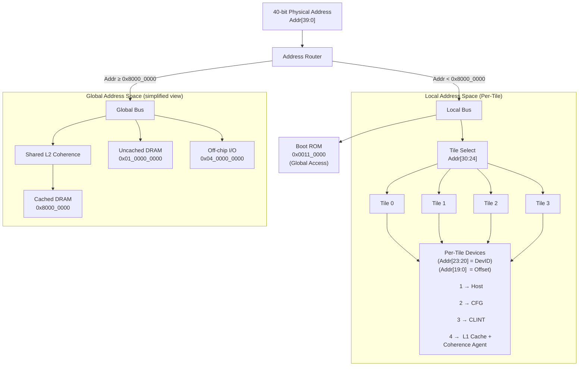

### Address Routing Overview

| Field              | Bits / Condition        | Description                                  |
|--------------------|------------------------|----------------------------------------------|
| Physical Address   | Addr[39:0]             | 40-bit physical address space                |
| Local Region       | Addr < 0x8000_0000     | Routed to per-tile local address space       |
| Global Region      | Addr ≥ 0x8000_0000     | Routed to global memory and I/O space        |

### Local Address Space (Per-Tile)

| Field        | Bits         | Description                                  |
|--------------|--------------|----------------------------------------------|
| Tile Select  | Addr[30:24]  | Selects tile (up to 128 tiles)               |
| Device ID    | Addr[23:20]  | Selects device within tile (up to 16)        |
| Offset       | Addr[19:0]   | Offset within device (1 MB per device)       |

#### Per-Tile Devices

| DevID | Device Description                |
|-------|----------------------------------|
| 1     | Host Interface                   |
| 2     | Configuration (CFG)              |
| 3     | CLINT                            |
| 4     | L1 Cache + Coherence Agent       |

### Special Local Region

| Component | Address Range     | Description                                      |
|-----------|-------------------|--------------------------------------------------|
| Boot ROM  | 0x0011_0000       | Boot ROM (globally accessible via local space)   |

### Global Address Space (Simplified)

| Region                     | Address Range              | Description                                      |
|----------------------------|----------------------------|--------------------------------------------------|
| Cached DRAM               | 0x00_8000_0000 – 0x00_FFFF_FFFF | Cached global memory (via L2)               |
| Uncached DRAM (L2 Cached) | 0x01_0000_0000 – 0x01_7FFF_FFFF | L1 uncached, L2 cached                      |
| Uncached DRAM (Fully UC)  | 0x01_8000_0000 – 0x01_FFFF_FFFF | L1 + L2 uncached                           |
| Accelerator Region        | 0x02_0000_0000 – 0x03_FFFF_FFFF | Streaming / accelerator space              |
| Off-chip I/O              | 0x04_0000_0000 – 0xFF_FFFF_FFFF | External devices / I/O                     |

### Global Routing Components

| Component              | Description                                      |
|------------------------|--------------------------------------------------|
| Global Bus             | Handles all global address traffic               |
| L2 Coherence Engine    | Routes cached memory accesses to DRAM            |

---

# FLOW CHART

